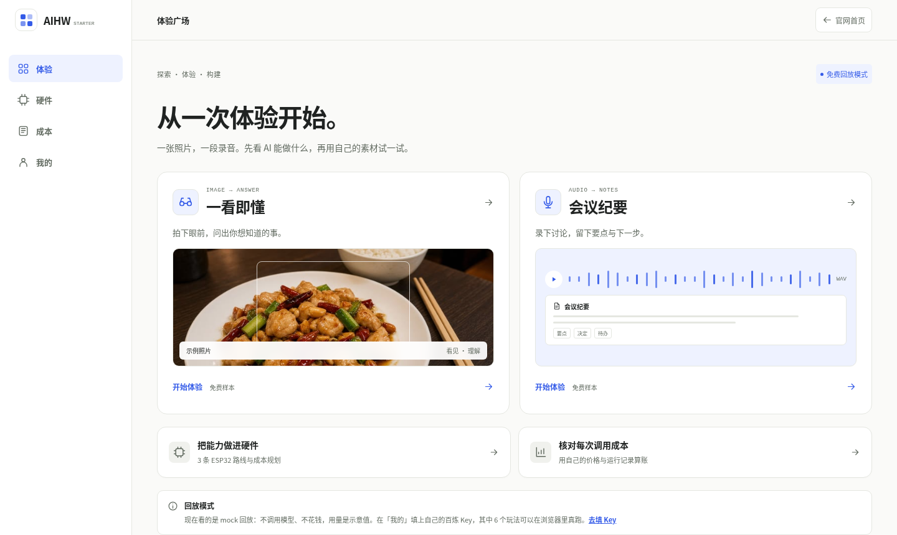

<div align="center">

<a id="-ai-hardware-starter"></a>

# AI Hardware Starter

**把 AI 能力，做成真实产品。**

AI 硬件行业热门品类的商业化最佳实践案例库

从「这门生意能不能做、怎么搭、怎么算账」出发的工程化案例集

**[官网](https://smile-xuc.github.io/aihw-starter/) · [体验中心](https://smile-xuc.github.io/aihw-starter/app/) · [技术方案](./solutions/by-solution/) · [贡献](./CONTRIBUTING.md)**

[](https://creativecommons.org/licenses/by/4.0/)
[](./LICENSE)
[](./CONTRIBUTING.md)

[开始](#快速开始) · [方案分层](#ai-硬件方案分层) · [九品类](#热门品类) · [参考 demo](#百炼参考-demo) · [贡献](#参与贡献)

</div>

<p align="center">
  <a href="https://smile-xuc.github.io/aihw-starter/app/">
    
  </a>
</p>

<p align="center"><sub>先看免费样本，再用自己的素材体验。浏览器真实调用仍待真 Key 验证。</sub></p>

## 快速开始

无需安装，打开[体验中心](https://smile-xuc.github.io/aihw-starter/app/)即可查看 9 个品类的方案回放、单次成本、硬件与合规要点。

| 你想做什么 | 从这里开始 |
|---|---|
| **先看 AI 能做什么** | [一看即懂](https://smile-xuc.github.io/aihw-starter/app/#/s/02-ai-glasses.bailian/default) · [会议纪要](https://smile-xuc.github.io/aihw-starter/app/#/s/07-recorder.bailian/default) |
| **理解方案厚薄** | [AI 硬件方案分层](#ai-硬件方案分层) |
| **判断产品与商业机会** | [九个品类](./solutions/by-category/) → 商业模式 → 技术方案 → 成本 |
| **动手实现一个方案** | [技术栈索引](./solutions/by-solution/) · [百炼参考 demo](#百炼参考-demo) |
| **了解行业与生态** | [AI 通识](./primer/) · [开源项目](./awesome/open-source/) · [在售产品](./awesome/commercial-products/) |

品牌商按「品类」找市场，开发者按「方案」找技术栈；两个维度可以交叉阅读。

## AI 硬件方案分层

> 查证/写入日：2026-10-26。

### 共同底座

几乎所有方案都以**语音**（或极简触控）做人机入口，背后至少有一层**意图分发 / 中控**：听懂要做的事，再路由到控制、问答或下游能力。差别不在「有没有语音」，而在入口后面挂了多厚。

### L1 · 交互与控制（轻量）

快问快答 + 设备控制。有中控 / 意图分发，但**没有**复杂 harness（不跑多步规划、工具编排、长任务）。算力与业务逻辑都薄，授权价最低，常见约 **1～10 元/台/年**，市场上也有 **<5 元/设备终身** 的方案。智能音箱、简单物联、基础语音遥控多落在这一层。

### L2 · 任务完成（Harness）

语音仍是界面，后面接本地或云端 **harness / agent 运行时**，用工具、记忆、多步推理把事做完。例如 Qwen Live Harness、DeepSeek Harness、千问办公、WorkBuddy。相对 L1，贵在「能办事」，不在「能听见」。

### L3 · 生成与外设闭环

仍以语音为界面，再叠生图、生视频等生成能力，必要时接到打印机、机器人等物理输出，形成「说一句 → 生成 → 落地」。儿童打印机「一句话生图并打印」是典型。L3 可叠在 L1 或 L2 之上：只生成也可以很轻；若生成前还要多步任务规划，则 **L2+L3** 同在。

### 怎么读后面的案例

优先看三问：

1. 入口是否语音 / 极简界面？
2. 有没有 harness（能否完成多步任务）？
3. 有没有生成或物理输出闭环？

品类卡片写「AI 在哪」时，建议落到 **L1 / L2 / L3**（可叠加），避免只写「带 AI」。

<details>
<summary><strong>展开完整阅读路线：方案商 / 品牌商、开发者、生态研究</strong></summary>

### 🏭 方案商 / 品牌商

1. 看 [solutions/by-category/](./solutions/by-category/) — 品类总览（IPC / 玩具陪伴 / 耳机 / 录音卡 …）
2. 进入感兴趣的品类目录（如 [`solutions/by-category/01-ipc/`](./solutions/by-category/01-ipc/)）
3. 读 [01-business.md](./solutions/by-category/01-ipc/01-business.md) 判断值不值得投入
4. 读 [02-solution.md](./solutions/by-category/01-ipc/02-solution.md) 看技术方案
5. 读 [03-cost.md](./solutions/by-category/01-ipc/03-cost.md) 算清楚账

### 👩‍💻 开发者

1. 看 [solutions/by-solution/](./solutions/by-solution/) — 方案总览（千问大模型 / 小智 / 端侧 …）
2. 选定方案后回到具体品类的 [demo/](./solutions/by-category/01-ipc/demo/)
3. 跑通示例 → 改造成自家产品
4. 做实时语音机器人？看 [Omni 实时端到端 · Runtime Host](./solutions/by-solution/01-qwen/omni-realtime/)
5. 百炼参考 demo：9 个品类各一个，填自己的 Key 三步跑通、没有 Key 自动走 mock，入口见下方[百炼参考 demo](#百炼参考-demo)，标准见 [demo-standard](./solutions/demo-standard/README.md)

### 🔍 了解生态

- [primer/](./primer/) — AI 通识：开放权重、规格与芯片、KV 量化、Token 计费、蒸馏、端云、记忆
- [awesome/open-source/](./awesome/open-source/) — 138+ 个 GitHub 开源项目，15 品类
- [awesome/commercial-products/](./awesome/commercial-products/) — 在售商业产品
- [项目官网](https://smile-xuc.github.io/aihw-starter/) — GitHub Pages 总览

</details>

## 网页 APP

新增[能力实验室](https://smile-xuc.github.io/aihw-starter/app/#/lab)：CLI 命令模板、媒体证据时间线、纯语音任务编排、视觉上下文演练。附[四组能力的本地开发路径](./solutions/by-solution/12-agent-capabilities.md)，样本与真实服务依赖分别标注。

「一看即懂」与「会议纪要」提供照片、录音的免费样本，也支持选择自己的素材预览，配置自己的 Key 后运行。「一看即懂」提供识别物品、读取文字、翻译、解释四个快捷问题，结果单列「看不清／无法确定」部分。体验中心与官网使用同一套视觉，手机、平板与桌面均可访问。

会议纪要支持原句回溯、负责人／期限修正，以及需要 [自托管 BYOK 网关](./services/asr-gateway/README.md) 的实时录音：临时／确认字幕、暂停／恢复、尾句收尾和只重试摘要。仓库没有公共网关，真实 API／计费和手机实机仍待验收。

[体验中心](https://smile-xuc.github.io/aihw-starter/app/)把 9 个品类的百炼参考方案做成「方案索引 + 回放」，每个方案页回答四个问题：效果怎样、一次多少钱、做成产品要什么硬件、有哪些合规义务。手机上可以添加到主屏当 APP 用，看过的回放离线也能看。

- **回放**：9 个方案都能直接看，不需要 Key，不调用云端模型
- **浏览器真跑**：在「我的」页填自己的百炼 Key 后，01 IPC、02 眼镜「拍照即问」、04 Agent 硬件、07 录音卡、08 手表、09 具身可以在浏览器里真跑（均待真 Key 验证）。看说体验、03 玩具、05 桌宠、06 同传耳机和 02「给 AI 打电话」用同一条官方实时连接：Key 只放进发往官方域名的 WebSocket 参数。画面条件提醒在看说体验里另开一条连接。到点提醒在看说体验里另读一句。说出来的提醒会排好队，等当前这句话播完再依次播出。可以说「不用盯了」，或点停止监视、停止解说，只停这一项，不用结束通话。通话中可以麦克风静音或播报静音。麦克风静音后声音不再送进通话和监视，大约每 30 秒送一秒静音来保持连接。播报静音会立刻停掉正在说的话，还没播的提醒不再补播。音色默认 Tina，可换成 qwen3.8 支持的预设。这一通已经接通时，主对话仍用接通时的音色；监视、到点提醒和下一次通话用新的。复刻音色仍在 Mac 上。可以说「把条件改成只看红字」，正在进行的这一项会按新的来，不用先取消。改提醒时间会从现在重新计。可以说「持续报告我手机屏幕里的内容」，或「关注我的身体，咳嗽了就提醒」。前台先接住，后台再看再查，结果稍后才说。持续报告屏幕和咳嗽提醒可以同时进行，后说的一项不会把另一项停掉。说「咳嗽了提醒我一次」，提醒过就停。说「从现在开始关注」，会一直听，同一次里不重复说。报告屏幕时只看画面，不把麦克风送进这一项。咳嗽和身体提醒只听声音，不送画面。说「把这个交给编码助手」，前台马上说明这个页面没有编码后台，不会假装已经开始。说「咳嗽了就提醒我喝水」，提醒的是喝水，不是只说听到了咳嗽。说「有人叫我名字就说我在」，已经在听的咳嗽提醒会继续。这个页面同时最多两项监视。说「持续报告屏幕，每次只说一句很短的话」，后台按这句原话的详略来讲。同一轮里已经在查的问题，或已经开始的提醒，不会再开一条。同一句话里要持续报告屏幕、又要咳嗽提醒时，两项都会开始。问到事实时，只有确认这次联网了，才会说查过网上。这一通最长 30 分钟，到点会结束通话，持续报告和监视也停下。正在查或正在看的一项可以停下，停下后结果不再说出来。已经发出的请求仍会计费。查询和看图的结果由单独的播报说出，不再占用主对话。查到或看到的结果会留给这一通对话，之后追问可以直接用。持续报告和咳嗽提醒说过的话也会留下。播报静音时，还没说的查询和看图也不再补播。你一开口，正在读的查询或看图会停住，不再补播。持续报告和咳嗽提醒会等你说完再讲。还没读完的结果留在这一通。你问到这件事会直接说。麦克风和摄像头可以换成这台设备上的其他输入，通话中更换会接着这一通。通话中也可以改实时画面或按需看一眼。这一通还没送过画面时，改成实时画面会新开一条连接，计时接着算。持续报告和监视听久了会换一条后台连接，这一项接着做。缺一帧或一小段声音就跳过这一轮。问到事实时最多等 25 秒。超时就说没查成，不会再发一次。通话中也可以换记忆库，接下来用这一套，长期资料在挂断时整理。一帧太大就再缩小后送出。缩不到限制内就跳过这一帧，通话、持续报告和监视接着做。问以前看到的画面时，相距不到 10 分钟的观察只留一条。持续报告或咳嗽提醒有字但没有声音时，会另读一次。没读出来这项也接着做。模型没答上、回答 15 秒还没开始，或你开口后 2 秒还停不掉当前回答，会换一条连接接着通话，计时不重算。工具回执后的回答超过 2 分钟也会换。持续报告和监视先接着做。换了两次仍没接上，这一通才结束。放进这一通的长期资料每项最多 6 条。整段超过 800 字时，先拿掉关系，再拿掉兴趣、偏好、外形、习惯和长期目标。姓名和长期角色会留下。视觉记忆这一帧最多等 60 秒。记下或没记下之后，再隔 60 秒看下一帧。还没有画面时，2 秒后再试。额度不够时这一通马上结束，不会再换一条连接。请到百炼控制台看额度。持续报告和监视也停下。看画面第一次没看上，会用同一张画面再看一次，这次只说两句短话。两次加起来最多 50 秒。挂断后整理长期资料最多等 2 分钟。超过就这次不写入，也不会再收成一段摘要。已经发出的请求仍会计费。你用英文说话，或说「请用英文和我说话」之后，这一通改用英文回答，查询和看图的播报也用英文。说「请用中文和我说话」就改回中文。OK 这种短句不会改语言。改用英文之后，提示里不再同时要求用中文回答。放进这一通的长期资料按姓名、长期角色、长期目标、习惯、外形、偏好、兴趣、关系排列。记下画面和挂断后整理长期资料时，都按温度 0 生成。记一帧最多 400 token，整理最多 2048 token。整理写到上限还没写完，这次不写入，再收成一段摘要。咳嗽这类持续提醒说完后，先停 3 秒，这 3 秒不再交给模型。只有这一项在听声音时，这 3 秒的声音会丢掉。安静一轮之后才会再提醒。持续报告屏幕的间隔不变。问事实或看画面的问题最长 4096 字，不再截成几百字。问题空了、超长，或带了别的参数，这次不查、不看，也不会发出请求。问事实时，问题里有控制字符也不查。查询或看图的结果里如果出现工具调用，这次不算查到或看清。查到或看到的最新一条结果会把完整内容留在这一通里，最长 16000 字，之后追问可以用。更早的查询和看图只留开头大约 180 字。说出来的仍是开头大约 180 字。持续报告和咳嗽提醒仍只留下刚说的那句。查到或看到的内容超过 16000 字，或拆成超过 64 段，这次不算查到或看清，也不会截短后当成完整结果。看画面的结果里有控制字符，这次没看清，也不会再看一次。记下的长期事实按原句保存，一条最长 800 字。每一项只留最近 6 条，更早的不再保存。姓名仍最多 40 字。放进这一通时，整段仍最多 800 字。记下的近期事项也按原句保存，一条最长 1200 字。放进这一通时最多 20 条，整段最多 1200 字。连续解说也走这条连接，没有明显变化不出声。记忆库可以新建或切换，通话中更换会从下一句开始用这一套，长期资料在挂断时整理，长期事实留在这台浏览器。问更早的对话时用 `text-embedding-v4` 检索，失败时退回关键词。提到昨天或上周时按时间加权，最多留 40 句。视觉记忆默认关闭，打开后大约每 60 秒记下看到的环境。结束通话后把这次对话更新进长期资料和近期事项。通话中记下的长期事实和刚检索到的内容会立刻写进这一通的提示，不必等挂断。对话会按最多 4 句、约 1000 字或停顿 60 秒收成片段，这台浏览器最多留 80 段，这些片段会计算向量，问更早的对话时和关键词、时间一起用，另计费，向量只留在这台浏览器。近期事项超过 90 天，或即将发生的日期过了 2 天，就不再放进通话。快到的事会优先写进提示，并带上记下的时间。这台浏览器最多留 40 条。长期事实最多 128 条、每条 200 字，按编号修改或删除；满了不再新增，也不会把更早的挤掉。结束通话时，这一通新记下的事实最多取 64 条交给整理；这一通没有新事实时才用对话摘录。后台委托仍只在 Mac 上的 Qwen-Live-Harness
- **用户自带 Key（BYOK）**：凭证保存在本机；文件识别／摘要直连百炼，会议实时录音经你配置并确认的网关转发。Key 不写入 URL 或历史；页面不加载第三方脚本
- **数据来自 demo**：方案注册表、回放轨迹和样本由 [demo 标准](./solutions/demo-standard/README.md)的生成器从各品类 `demo/bailian/` 产出，新增一个方案不用改 APP 代码

页面结构、数据格式与本地预览见 [`docs/app/README.md`](./docs/app/README.md)。早先的[功能广场可点击原型](./docs/designs/aihw-square/README.md)保留为设计存档。

## 把原理，也弄明白

[从语音聊天到语音 Agent：真正缺的是哪一层？](./docs/voice-agent-runtime.html)——以巡检草稿为完整任务，解释语音前台、编排状态与权限、后台执行，以及纯语音和视觉两条方案。能力实验室与文章分别交付、分别验收。

## 热门品类

九个品类均面向商业化方向；具体项目的开发者用途、商业化能力与验证进度，见各自资料。

| 品类 | 核心能力 |
|---|---|
| 01 · [IPC / AI 视觉](./solutions/by-category/01-ipc/) | 事件摘要、自然语言检索、自定义事件告警、每日总结、一键成片等 |
| 02 · [AI 眼镜](./solutions/by-category/02-ai-glasses/) | 视觉问答（一看即懂）、同声传译、实时音视频交互、会议听记、屏显导航/提词 |
| 03 · [AI 玩具 / 陪伴 / 儿童伴学](./solutions/by-category/03-toys-companion/) | 爸妈声音陪伴（声音克隆）、学情日报、拍照问答、口语陪练等 |
| 04 · [Agent 硬件（如口袋助手、桌面盒子）](./solutions/by-category/04-agent-hardware/) | 多 Agent 协同 + 端云模型协同 |
| 05 · [桌宠](./solutions/by-category/05-desktop-pet/) | 动作情绪标签三路同步 + 每日记忆日记 + BLE 降级对话 + Agent 后台热配置 |
| 06 · [AI 耳机](./solutions/by-category/06-ai-earphone/) | 实时翻译 / 对话 / 听记多用途 |
| 07 · [录音卡 / 会议盒子](./solutions/by-category/07-recorder/) | ASR + 纪要 Agent，结构化纪要 |
| 08 · [智能手表 / 健康可穿戴](./solutions/by-category/08-smart-watch/) | 健康指标解读 + 订阅商业化 |
| 09 · [具身智能](./solutions/by-category/09-embodied/) | VLA 端云协同 + 多本体形态适配 |

九个品类的资料均为完整版，覆盖下方统一结构；资料完整不代表其中所有项目都已完成商业交付或实测。

## ✨ 亮点功能速览

精选覆盖 9 个品类的 13 个「Wow feature」（其中 1 个跨品类）——都是**能收费、有付费锚点**的功能，看完就懂 AI 硬件能做出什么样的产品。

<details>
<summary><strong>查看全部 13 项功能与付费锚点</strong></summary>

**📷 IPC · 自然语言找回放**

「找昨晚小孩跳沙发那段」→ 5 秒定位

付费锚点：AI 订阅 5~9.9 元/月（已知跑通）

**📷 IPC · 每日 AI 精彩片段**

自动剪出今日精彩 30 秒 vlog

付费锚点：云存 + AI 套餐加值

**👓 眼镜 · 一看即懂**

对着菜单/招牌看一眼 → 耳机播报翻译 + 推荐

付费锚点：硬件溢价 + 翻译功能包（探索期）

**👓 眼镜 · 给 AI 打电话**

按住镜腿即问即答，AI 实时看到眼前画面、边走边聊

付费锚点：旗舰档硬件溢价

**🧸 玩具 · 爸妈声音陪伴**

家长录 20 秒 → 孩子听到爸妈声音讲故事

付费锚点：硬件一次性溢价（亲情包）

**🧸 儿童伴学 · 每日学情日报**

自动告诉家长今天孩子学了啥、情绪如何、如何鼓励

付费锚点：伴学订阅（探索期）

**🤖 Agent 硬件 · 一句话办完多步任务**

「明早七点叫我，顺便查一下杭州天气，要是下雨就提前半小时」→ 端侧先办能办的，其余交给云端多轮编排，断网降级到端侧规则

付费锚点：硬件溢价（订阅已知难跑通）

**🪴 桌宠 · 情绪 → 动作联动**

AI 识别语气 → 触发实体机器人表情 / 摇头 / 摆手

付费锚点：硬件买断，云端成本摊进售价（订阅已知未跑通）

**🎧 AI 耳机 · 实时同传**

开会同声传译，不用看屏幕，边听边说

付费锚点：硬件溢价 + 可选时长 / 离线包

**🎙️ 录音卡 · 一键会议纪要**

会后 3 分钟出结构化纪要 + 待办 + 分角色发言

付费锚点：硬件 + 按时长 / 按月套餐（Plaud 等已跑通）

**⌚ 手表 · 每日健康日报**

一天的心率、血氧、睡眠指标 → 本地红线先判（命中立即震动）→ 表盘解读卡 + App 日报

付费锚点：硬件为主；健康会员订阅海外已跑通（Oura / WHOOP）

**🦾 具身智能 · 一句话指挥机械臂**

「把螺丝放进左边的盒子」→ 看腕部相机画面逐步定位、抓取、放置，每一步先过本地安全门

付费锚点：本体 + 集成交付（订阅已知未跑通）

**🧭 跨品类 · 随身硬件 · 一句话派活给 Agent**

路上对眼镜、耳机、录音卡或口袋设备说「把今天三场会整理成周报发给团队」→ 设备只当入口，任务交给云端或家里电脑上的 Agent（如 OpenClaw）去办，发出前先确认，办完推回结果——现实版私人助理

付费锚点：Agent 订阅 / 用量额度（探索期；[Meta 称](https://about.fb.com/news/2026/09/introducing-muse-personal-ai-agent/)旗下个人 Agent Muse 多数用途免费，另有订阅方案）

</details>

> 想看完整功能清单和商业化打法？进入对应品类的 [`solutions/by-category/`](./solutions/by-category/) 目录。

## 每个品类包含什么

```
solutions/by-category/0X-xxxx/
├── README.md        # 1 分钟读完的品类概述
├── 01-business.md   # 商业模式与市场判断
├── 02-solution.md   # 技术方案：推荐架构 + 接入步骤 + 代码示例
├── 03-cost.md       # BOM + 云端用量 + 算账模型
├── 04-cases.md      # 脱敏案例与公开案例
├── 05-faq.md        # 客户高频问答
└── demo/            # 最小可跑 demo（Python）
    └── bailian/     # 百炼参考 demo：python3 run.py，无 Key 自动 mock
```

## 百炼参考 demo

9 个品类各有一个百炼参考 demo，路径统一为 `solutions/by-category/<品类>/demo/bailian/`。在 `.env` 填好 Key 后运行 `python3 run.py`（Windows 用 `python run.py`）；没有 Key 时同一条命令自动进入 mock，离线回放、不联网、不计费。目前均为「待真 Key 验证」，验证记录见各自目录的 `VERIFY.md`，统一标准见 [demo-standard](./solutions/demo-standard/README.md)。每个条目的网页入口可以直接看同一条链路的回放。

<details>
<summary><strong>查看 9 个品类的 demo、模型链路与网页回放入口</strong></summary>

### 📷 01 IPC

事件抓拍 → `qwen3.7-flash` 看图生成事件卡 → 自然语言检索 → 看护日报

[`01-ipc/demo/bailian/`](./solutions/by-category/01-ipc/demo/bailian/) · [回放 · 网页真跑](https://smile-xuc.github.io/aihw-starter/app/#/s/01-ipc.bailian)

### 👓 02 AI 眼镜

拍照即问：`qwen3.8-omni-flash` 看图听问 + `qwen-audio-3.0-tts-flash` 播报；`--realtime` 用 `qwen3.8-omni-flash-realtime` 给 AI 打电话

[`02-ai-glasses/demo/bailian/`](./solutions/by-category/02-ai-glasses/demo/bailian/) · [回放 · 拍照即问可网页真跑](https://smile-xuc.github.io/aihw-starter/app/#/s/02-ai-glasses.bailian)

### 🧸 03 玩具 / 陪伴

按键说话 + 眼睛摄像头 → `qwen3.8-omni-flash-realtime` 实时语音回复，Function Calling 控制动作与灯光

[`03-toys-companion/demo/bailian/`](./solutions/by-category/03-toys-companion/demo/bailian/) · [回放](https://smile-xuc.github.io/aihw-starter/app/#/s/03-toys-companion.bailian)

### 🤖 04 Agent 硬件

端侧规则先执行 → `qwen3.8-flash` Function Calling 多轮编排本地设备与云端服务，断网降级到端侧规则

[`04-agent-hardware/demo/bailian/`](./solutions/by-category/04-agent-hardware/demo/bailian/) · [回放 · 网页真跑](https://smile-xuc.github.io/aihw-starter/app/#/s/04-agent-hardware.bailian)

### 🪴 05 桌宠

`qwen3.8-omni-flash-realtime` 实时语音 + 表情动作工具；结束时 `qwen3.7-flash` 写陪伴日记、提炼记忆

[`05-desktop-pet/demo/bailian/`](./solutions/by-category/05-desktop-pet/demo/bailian/) · [回放](https://smile-xuc.github.io/aihw-starter/app/#/s/05-desktop-pet.bailian)

### 🎧 06 AI 耳机

`qwen3.8-livetranslate-flash-realtime` 实时同传：英文字幕 + 译音，自动区分说话人

[`06-ai-earphone/demo/bailian/`](./solutions/by-category/06-ai-earphone/demo/bailian/) · [回放](https://smile-xuc.github.io/aihw-starter/app/#/s/06-ai-earphone.bailian)

### 🎙️ 07 录音卡

录音文件上传 → `qwen-audio-3.1-asr-flash-filetrans` 异步识别 → `qwen3.8-flash` 结构化纪要。单声道尝试说话人分离，双声道完整识别两轨；摘要、决策、待办可分别复制。临时存储 48 小时有效，官方不用于生产；浏览器上传 CORS 与真实模型调用仍待验证。文件识别首响应包含上传、排队和转写，缺完整 Token 时总费用未知。

[`07-recorder/demo/bailian/`](./solutions/by-category/07-recorder/demo/bailian/) · [回放 · 网页真跑](https://smile-xuc.github.io/aihw-starter/app/#/s/07-recorder.bailian)

### ⌚ 08 智能手表

本地红线规则先判 → `qwen3.7-flash` 健康日报 → 表盘卡片，可选抬腕语音播报

[`08-smart-watch/demo/bailian/`](./solutions/by-category/08-smart-watch/demo/bailian/) · [回放 · 网页真跑](https://smile-xuc.github.io/aihw-starter/app/#/s/08-smart-watch.bailian)

### 🦾 09 具身智能

腕部相机画面 + 指令 → `qwen3.8-flash` 看图逐步调用技能，每次调用先过本地安全门

[`09-embodied/demo/bailian/`](./solutions/by-category/09-embodied/demo/bailian/) · [回放 · 网页真跑](https://smile-xuc.github.io/aihw-starter/app/#/s/09-embodied.bailian)

</details>

## 仓库结构

<details>
<summary><strong>展开目录：品类 × 方案、生态资料与网页体验</strong></summary>

```
aihw-starter/
├── solutions/
│   ├── README.md              # 双维度入口说明（品类 × 方案）
│   ├── by-category/           # 品类总览 + 各品类内容
│   │   ├── README.md          # 品类总览表格
│   │   ├── 01-ipc/            # IPC / AI 视觉
│   │   ├── 02-ai-glasses/     # AI 眼镜
│   │   ├── 03-toys-companion/ # AI 玩具 / 陪伴
│   │   ├── 04-agent-hardware/ # Agent 硬件（口袋助手、桌面盒子）
│   │   ├── 05-desktop-pet/    # 桌宠
│   │   ├── 06-ai-earphone/    # AI 耳机
│   │   ├── 07-recorder/       # 录音卡 / 会议盒子
│   │   ├── 08-smart-watch/    # 智能手表 / 健康可穿戴
│   │   └── 09-embodied/       # 具身智能
│   ├── by-solution/           # 方案总览（千问 / 小智 / 端云协同 / 视频配音 / Qwen Audio Agent …）
│   ├── demo-standard/         # 参考 demo 统一标准、模板与 CI 自检；生成网页 APP 的注册表与回放
│   └── benchmark/             # 方案延迟横评实测
├── awesome/
│   ├── open-source/           # 开源项目索引（138+ 项目，15 品类）
│   └── commercial-products/   # 在售商业化产品案例
├── primer/                    # AI 通识（01–07：授权 / 规格 / KV / Token / 蒸馏 / 端云 / 记忆）
├── docs/                      # GitHub Pages：项目官网与交互式学习页
│   ├── app/                   # 网页 APP：方案回放 + 浏览器真跑
│   └── designs/aihw-square/   # 功能广场 APP 原型（设计存档）
├── .github/workflows/         # CI：demo 冒烟、链接检查、Pages 构建与 APP 冒烟
├── faq.md                     # 跨品类通用 FAQ
├── CHANGELOG.md               # 版本记录
└── CONTRIBUTING.md            # 贡献指南
```

</details>

## 参与贡献

欢迎以下贡献：

| 贡献类型 | 说明 |
|---|---|
| **新增品类** | 在 `solutions/by-category/` 下新建目录，提交完整 6 文件 + demo |
| **新增方案** | 在 `solutions/by-solution/` 新增方案页；品类内接入差异写进对应品类现有 `02-solution.md` 的小节 |
| **新增案例** | 在对应品类 `04-cases.md` 加脱敏案例，或在 `awesome/` 加产品记录（商业产品卡须写明具体的 AI 功能，见收录门槛） |
| **新增开源项目** | 补充到 `awesome/open-source/by-category/` 对应文件 |

详细规则参见 [CONTRIBUTING.md](./CONTRIBUTING.md)。PR 会自动跑 demo 冒烟（无 Key、走 mock）与链接检查；改到 `docs/`、百炼 demo 或 demo 标准时，还会跑 Pages 构建与网页 APP 冒烟测试。

[](https://github.com/smile-xuc/aihw-starter/actions/workflows/demo-smoke.yml)
[](https://github.com/smile-xuc/aihw-starter/actions/workflows/pages.yml)

## 反馈与交流

- **[Issue](https://github.com/smile-xuc/aihw-starter/issues)**：报问题 / 提建议 / 申请收录 / 行业讨论与经验交流
- **商业化合作**：新建 Issue，标题以 `[business]` 开头

> 仓库暂未开启 GitHub Discussions；交流统一走 Issue，避免空转入口。

## License

| 内容 | 协议 |
|---|---|
| 文档（Markdown、表格、示意图） | [CC BY 4.0](https://creativecommons.org/licenses/by/4.0/) — 可自由复制、修改、商用，需注明来源 |
| 代码（`demo/` 下的脚本与示例） | [MIT](./LICENSE) — 可自由使用，无担保 |

> **SDK 协议说明**：demo 中引用的第三方 SDK（如 DashScope / 百炼 API）遵循其原厂服务协议，MIT 仅覆盖本仓库自身的示例代码。
